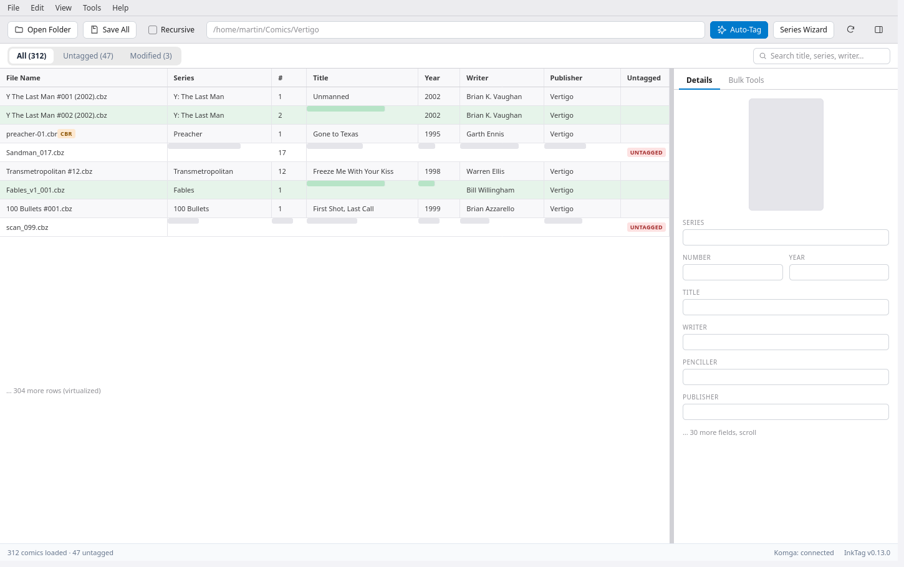
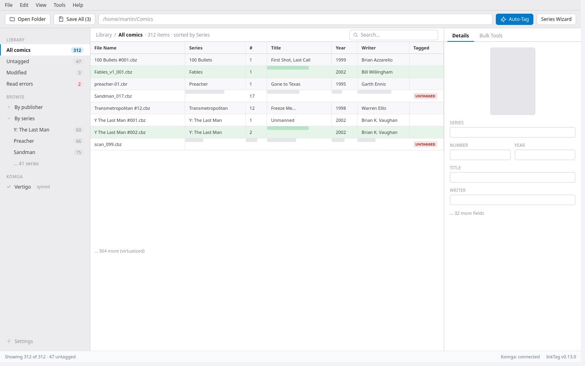
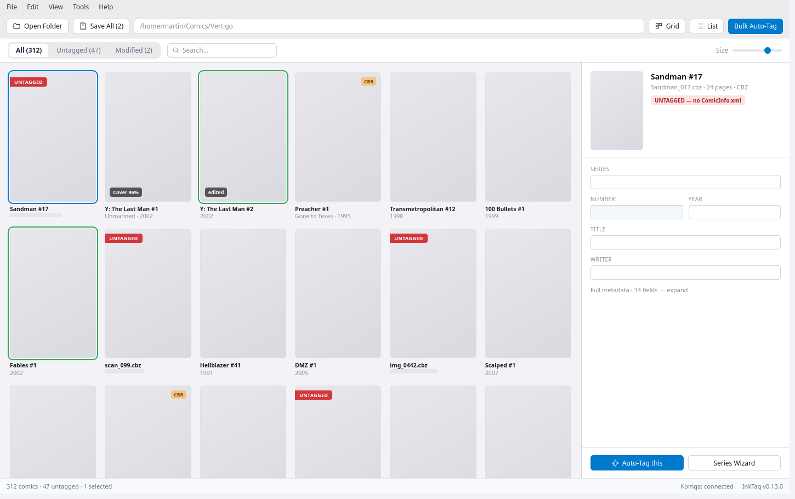
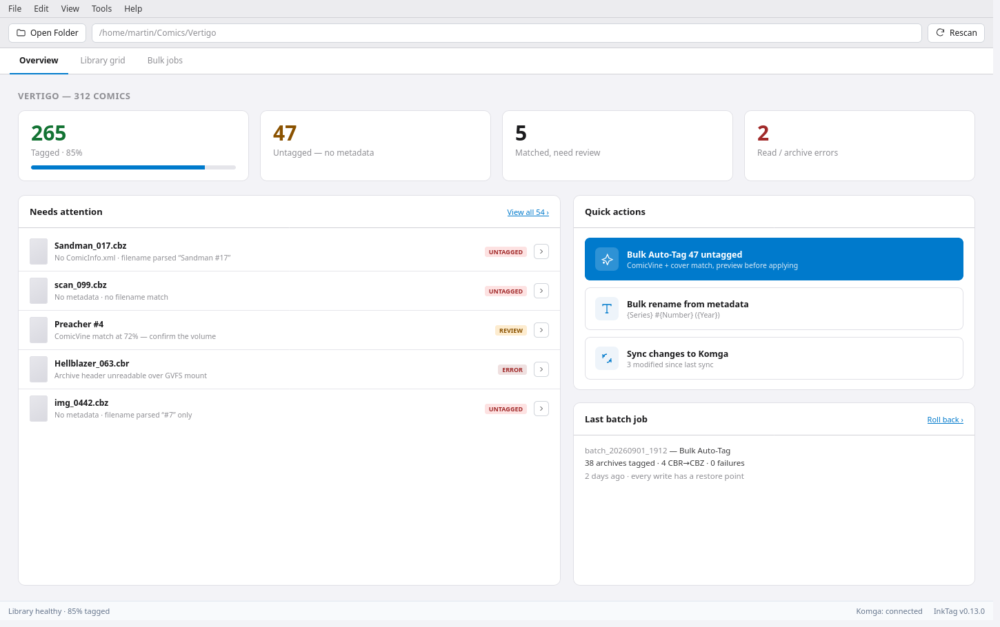
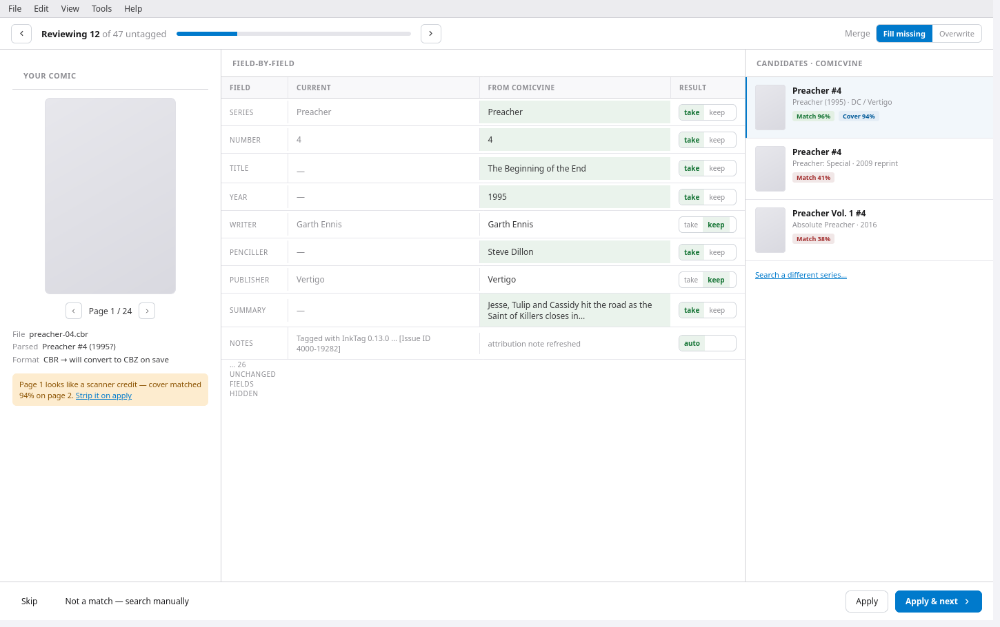

# InkTag — layout explorations

Five directions for the `InkTag.Gui` main window. All share the current visual
language (colours and type lifted from `src/InkTag.Gui/App.axaml`, light theme);
what changes is the **information architecture**, not the aesthetic.

These are wireframe mockups for discussion — nothing here is committed to. Editable
sources are in [`artboards/`](artboards/) (Claude Design `.dc.html` + `canvas.json`);
an interactive pan/zoom version of all five is at the canvas linked from the PR / chat.

---

## Current

Menu bar → toolbar → segmented filter pills → full-width 35-column `DataGrid` →
right inspector (Details / Bulk Tools tabs). Workflows (bulk scrape, rename
preview, series wizard, scraper match) are modal windows.

**Strengths:** dense, every field visible and editable in place, familiar
spreadsheet model, good for column-wide bulk edits.
**Limits:** no way to navigate a large library except scroll + search; the cover
(the thing the app is best at matching) is a small thumbnail; the tagging
workflow is a stack of blocking dialogs.

---

## A · Library Rail

Adds a ~220px left nav rail. The filter pills become persistent smart-lists
(**Untagged 47**, **Modified 3**, **Read errors 2**) that are always in view, and
a **Browse** tree lets you drill in by publisher or series without typing. Grid
and inspector are otherwise unchanged.

**Motivation:** the most common questions ("what still needs tagging?", "show me
just Preacher") stop requiring a search. Lowest-risk change — it's additive.
**Tradeoff:** costs ~220px of horizontal space; the rail duplicates some of what
the filter pills did.

---

## B · Cover Wall

Covers replace rows. Status reads visually — a red `UNTAGGED` ribbon, a green
outline for unsaved edits, a `CBR` badge, a `Cover 96%` match chip. Selecting a
comic opens a side drawer for editing, with **Auto-Tag this** right there.

**Motivation:** leans into InkTag's identity (perceptual cover matching). Scanning
a folder for "which of these is a bad rip / wrong cover / untagged" is a glance,
not a column read.
**Tradeoff:** poor for editing one field across 40 comics; needs a size slider
and a list-view fallback (both shown in the toolbar).

---

## C · Health Dashboard

The app opens on a library-health overview: stat tiles (**265 tagged / 85%**,
**47 untagged**, **5 need review**, **2 errors**), a *Needs attention* queue with
per-row actions, big primary actions (**Bulk Auto-Tag 47 untagged**, rename, Komga
sync), and the last batch job with a one-click rollback. The grid is a tab away.

**Motivation:** reframes the app around the outcome ("get my library tagged")
rather than the mechanism ("edit cells"). New users land somewhere that tells
them what to do.
**Tradeoff:** adds a screen to navigate; power users who just want the grid have
one extra click every launch (mitigable — remember the last tab).

---

## D · Tagging Workspace

The modal `ScraperMatchWindow` becomes a full screen you *live in* while working a
queue: local cover + page switcher + parsed query + intro-page flag on the left,
a field-by-field diff (with per-field take/keep and a merge-mode toggle) in the
centre, ComicVine candidates with `Match %` / `Cover %` on the right, and
**Skip / Apply / Apply & Next** along the bottom. Progress ("Reviewing 12 of 47")
is always visible.

**Motivation:** turns bulk tagging from "open dialog, decide, close, repeat" into
a fast keyboard loop.
**Tradeoff:** only useful while actively tagging — it's a mode, not the home
screen. Pairs naturally with C (dashboard → "review 47" → this).

---

## Not mutually exclusive

- **A + C** is the most likely real combination: dashboard as the landing tab,
  library rail on the grid tab.
- **D** slots under any of them as the "review matches" destination.
- **B** could be a third view toggle (`Grid | Covers | List`) rather than a
  wholesale replacement.
